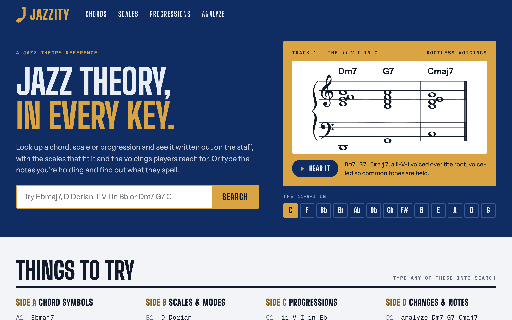
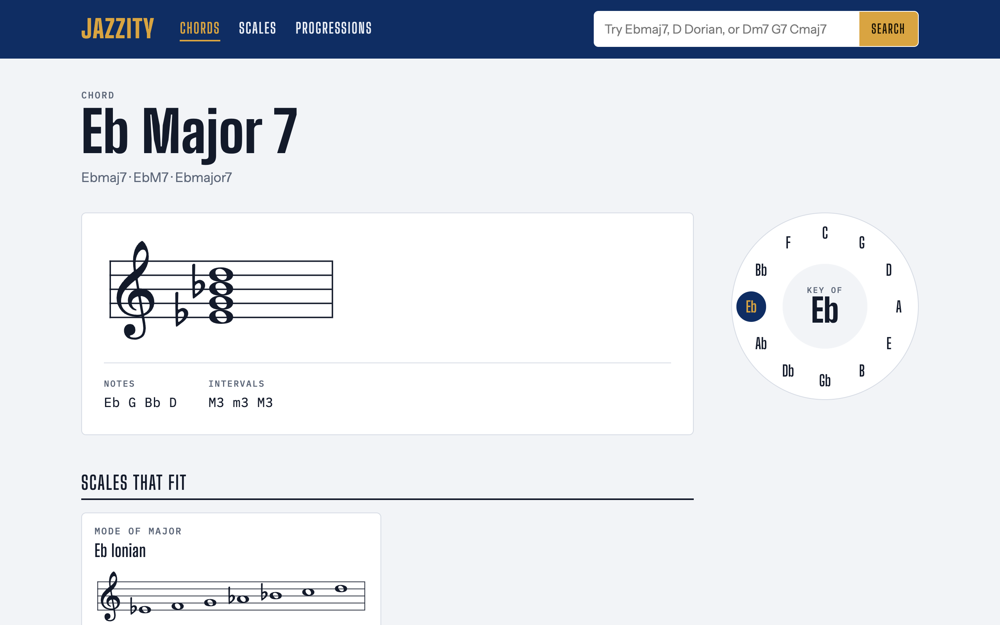
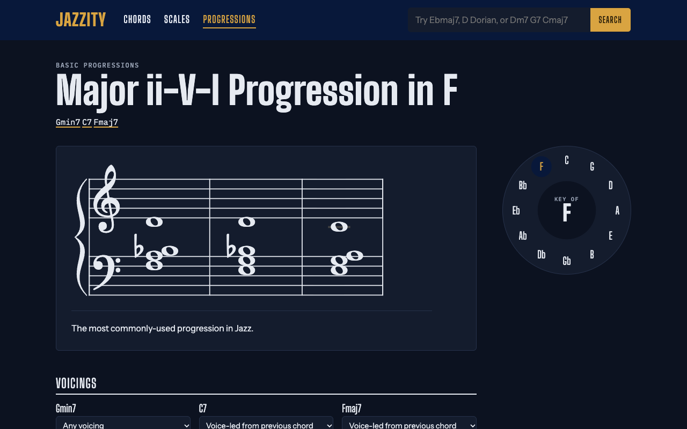

# Jazzity

[](https://github.com/eigenben/jazzity/actions/workflows/ci.yml)

A jazz theory reference that works in every key. Look up a chord, scale or progression and see it written out on the staff, along with the scales that fit it and the voicings players use. You can also type the notes you're holding and Jazzity tells you which chords they spell.



## What it does

- **Chords**: every chord quality in all twelve keys, with its intervals, alternate symbols, the scales that fit it, and common voicings on a grand staff.
- **Scales and modes**: parent scales (major, melodic minor, diminished, bebop…) and the modes built on each degree.
- **Progressions**: 36 cadences, turnarounds, chains of ii-Vs, blues and tune forms (backdoor ii-Vs, Coltrane changes, the Bird blues, rhythm changes…), each with notes on what to listen for. Each is shown as a lead sheet, chord symbols in the key over their roman numerals, and voiced on a grand staff so each chord moves smoothly to the next. Pick a voicing family (rootless, shells, guide tones or rooted), or a specific voicing for any chord, and try one-click reharmonizations: tritone substitutes, related ii chords, backdoor dominants and passing diminished chords.
- **Analysis**: type some changes (`Dm7 G7 Cmaj7 A7`) and Jazzity finds their key, names each chord with a roman numeral and its role (secondary dominants as `V7/ii`, tritone substitutes as `subV7`, borrowed chords), points out the ii-Vs and turnarounds inside them, and suggests a scale for each chord.
- **Search that understands notation**: chord symbols however they're written (`Bb-7`, `Cø7`, `C^7`, `C7(b9)`), scales and modes with their key either side (`dorian D`, `f# melodic minor`), roman numerals (`ii V I in Eb`, `iiø V i`, `251`), chord changes (`Dm7 | G7 | Cmaj7`, `analyze Dm7 G7 Cmaj7 A7`) and notes (`D F A C, G B D F`) all go straight to the right page. Anything else is matched by name, typos and all, with suggestions as you type.

| Eb major 7 in context | A ii-V-I in F, voice-led (dark mode) |
| --- | --- |
|  |  |

## How it works

The theory lives in plain Ruby domain objects in `app/models`, rather than in lookup tables:

- **`Key`** models the 12 pitch classes and their enharmonic spellings. Each key has a chromatic index and a letter index, so transposing Eb up a major third gives G rather than F##. Progressions store each chord's scale degree as well as its distance in semitones from the key, so a ii-V-I in E reads F#m7 B7 Emaj7 rather than Gbm7 B7 Emaj7.
- **`Tones`** is an immutable collection of chord or scale degrees stored relative to C. `in_key_of` and `in_mode` return new collections, so one chord record can be shown in any key, and a scale can be rotated into any of its modes.
- **`Chord`**, **`Scale`**, **`Mode`** and **`Voicing`** are Active Record models that share that tone math through the `Toneable` and `KeyContext` concerns.
- **`ChordName`**, **`ScaleName`** and **`RomanNumerals`** parse what a musician types: a chord symbol in any of its usual spellings, a scale or mode with its key, or a progression in roman numerals that can be realized in any key.
- **`Chart`** reads a progression written as a lead sheet in roman numerals, `"A: | Imaj7 vi7 | ii7 V7 | % |"`: barlines, chords sharing a bar evenly, `%` for a repeated bar and labels for the sections of a form. The seeds write every progression this way, and the chart is stored with the progression and written out into its chords.
- **`HarmonicAnalysis`** scores every major and minor key by how well a run of chords fits it (diatonic chords, dominants resolving into the key, borrowed chords, V-I resolutions and where the changes start and end), then names each chord in the winning key and finds known progressions inside the changes. **`Reharmonization`** rewrites changes with the common substitutions.
- **`NoteSequence`**, **`ChordSequence`** and **`ChordNoteSequence`** parse free-form input ("C E G", "Dm7 G7 Cmaj7") and work out which chords, scales and progressions it matches, and move it into any key.
- **`Search`** tries those parsers first and goes straight to what the query names; otherwise it matches the names of chords, scales and progressions, allowing for typos.
- **`VoiceLeader`** voices a whole progression from one voicing family. For each chord it tries every voicing in the family at every octave that fits a comfortable register (rootless voicings in the right hand over the root, rooted ones in the left hand above the lower interval limits), then picks the sequence that moves the voices least, so common tones are held and the top voice moves by step.

All content is seed data in `db/seeds`. Staff notation is drawn in the browser by a small Stimulus controller using [VexFlow](https://github.com/vexflow/vexflow).

## Tech stack

- Ruby 4.0, Rails 8.1, SQLite
- Hotwire (Turbo and Stimulus) with importmap, so there's no Node build step
- VexFlow 5 for music notation
- RSpec, Capybara and shoulda-matchers; RuboCop, Brakeman and bundler-audit in CI

## Getting started

You need Ruby 4.0.2 (see `.ruby-version`).

```bash
git clone https://github.com/eigenben/jazzity.git
cd jazzity
bin/setup
```

`bin/setup` installs gems, creates and seeds the database, and starts the server at http://localhost:3000.

## Tests and checks

```bash
bundle exec rspec   # specs, including a crawl of every page reachable from the home page
bin/ci              # everything CI runs: RuboCop, security audits and specs
```

## Running with Docker

The production image includes the seeded database, so it needs no setup:

```bash
docker build -t jazzity .
docker run -p 3000:80 -e RAILS_FORCE_SSL=false jazzity
```

In production behind an SSL-terminating proxy, leave `RAILS_FORCE_SSL` unset and provide a stable `SECRET_KEY_BASE`.

## History

Jazzity started in 2010 as a Rails 3 app. In 2026 it was brought up to date: Ruby 4.0 and Rails 8.1, the jQuery/Sprockets frontend replaced with Hotwire and VexFlow 5, and a long-standing bug fixed where chords were always written in C whatever key you asked for.
